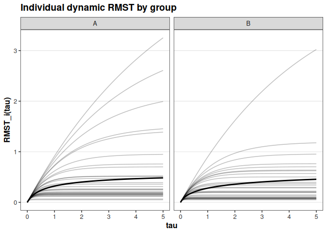
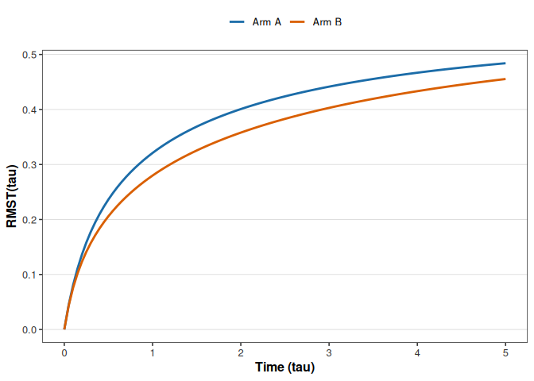
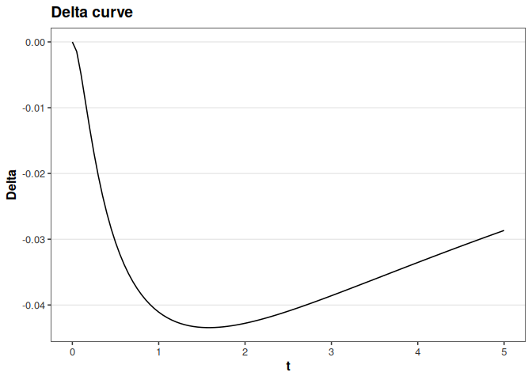
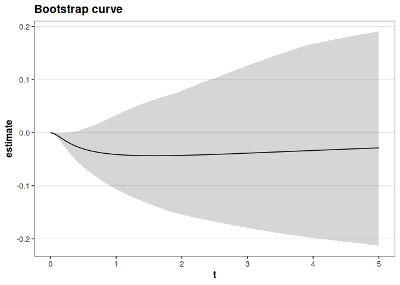

# tvrmst

[](https://CRAN.R-project.org/package=tvrmst)

**Time-Varying Restricted Mean Survival Time from Survival Matrices**

`tvrmst` is a matrix-first framework for computing dynamic restricted
mean survival time (RMST) curves, treatment contrasts, and bootstrap
confidence intervals.

The package separates survival estimation from functional summarization
and operates directly on subject-level survival probability matrices.

## Motivation

Restricted mean survival time (RMST) is defined as

$$
\mathrm{RMST}(\tau) = \int_0^\tau S(u)\,du.
$$

RMST is often more interpretable and robust than hazard ratios,
especially under non-proportional hazards. Most implementations target a
single horizon $\tau$. `tvrmst` extends this to the full dynamic curve:

$$
\tau \mapsto \mathrm{RMST}(\tau).
$$

This enables:

- Continuous-time treatment contrasts

- Time-dependent benefit visualization

- Individual-level RMST trajectories

## Mathematical Framework

For subject $i$, with predicted survival $S_i(t)$:

$$
\mathrm{RMST}_i(\tau) = \int_0^\tau S_i(u)\,du.
$$

Population mean dynamic RMST:

$$
\mathrm{RMST}(\tau) = \frac{1}{n}\sum_{i=1}^{n}\mathrm{RMST}_i(\tau).
$$

Two-arm contrast (A vs B):

$$
\Delta(\tau) = \mathrm{RMST}_B(\tau) - \mathrm{RMST}_A(\tau).
$$

All integrals use deterministic trapezoidal integration on a common time
grid.

## Design Principles

1.  **Matrix-first abstraction**: rows are subjects, columns are time
    points.

2.  **Model-agnostic workflow**: works with any upstream survival
    estimator.

3.  **Unbalanced-arm support**: group sizes can differ.

> `tvrmst` does not fit survival models.

## Installation

``` r
# install.packages("remotes")
remotes::install_github("ielbadisy/tvrmst")
```

## Core API

### Data structure

- `assurvmat()`
- `nobssurvmat()`
- `bindsurvmat()`

### Estimands

- `rmstdynamic()`
- `rmstdelta()`

### Bootstrap

- `bootstrapcurve()`
- `bootrmstdelta()`

### Visualization

- `plotrmstindividualbygroup()`
- `plotrmsttwoarms()`
- `plotdeltacurve()`
- `plotbootcurve()`

### Coercion helper

- `assurvprobmatrix()`

## Basic Workflow

### 1) Prepare two-arm survival matrices

``` r
library(tvrmst)
set.seed(1)

time <- seq(0, 5, by = 0.05)
nA <- 100
nB <- 80

lambdaA <- rexp(nA, rate = 0.2)
lambdaB <- rexp(nB, rate = 0.15)

S_A <- outer(lambdaA, time, function(l, t) exp(-l * t))
S_B <- outer(lambdaB, time, function(l, t) exp(-l * t))

xA <- assurvmat(S_A, time, group = rep("A", nA))
xB <- assurvmat(S_B, time, group = rep("B", nB))
x_all <- bindsurvmat(xA, xB)
```

### 2) Dynamic RMST

``` r
res_all <- rmstdynamic(x_all)
```

Key outputs:

- `res_all$individual`: subject-level dynamic RMST curves

- `res_all$mean`: population mean dynamic RMST curve

### 3) Two-arm contrast

``` r
d <- rmstdelta(xA, xB)
```

Returns full $\Delta(\tau)$ over the grid.

### 4) Bootstrap confidence intervals

``` r
boot <- bootrmstdelta(xA, xB, R = 300, seed = 1)
```

Computes percentile confidence bands pointwise along the delta curve.

## Visualization

``` r
plotrmstindividualbygroup(res_all, group = x_all$group)
```

<!-- -->

``` r
plotrmsttwoarms(xA, xB)
```

<!-- -->

``` r
plotdeltacurve(d$time, d$delta)
```

<!-- -->

``` r
plotbootcurve(boot)
```

<!-- -->

## Relation to Existing RMST Workflows

Compared with fixed-horizon RMST tools, `tvrmst` provides:

- Continuous dynamic RMST curves
- Individual RMST trajectories
- Direct compatibility with ML survival predictions
- A clean separation between model fitting and functional summarization

This supports modern benchmarking and production survival pipelines.

## Citation

``` r
citation("tvrmst")
```

    ## Warning in citation("tvrmst"): could not determine year for 'tvrmst' from
    ## package DESCRIPTION file

    ## To cite package 'tvrmst' in publications use:
    ## 
    ##   El Badisy I (????). _tvrmst: Time-Varying Restricted Mean Survival
    ##   Time from Survival Matrices_. R package version 0.0.9,
    ##   <https://CRAN.R-project.org/package=tvrmst>.
    ## 
    ## A BibTeX entry for LaTeX users is
    ## 
    ##   @Manual{,
    ##     title = {tvrmst: Time-Varying Restricted Mean Survival Time from Survival Matrices},
    ##     author = {Imad {El Badisy}},
    ##     note = {R package version 0.0.9},
    ##     url = {https://CRAN.R-project.org/package=tvrmst},
    ##   }

## License

MIT
